<div align="center">

<picture>
  <source media="(prefers-color-scheme: dark)" srcset=".github/assets/banner-dark.svg">
  
</picture>

**The complete, honest technical record of the PAM platform.**<br>
Architecture, APIs, tutorials, security boundaries, production operations, compatibility, and known limits for every official PAM product. Read it at **[push-in.github.io/pam-docs](https://push-in.github.io/pam-docs/introduction/)**.

[](https://github.com/push-in/pam-docs/actions/workflows/pages.yml)

[Read the docs](https://push-in.github.io/pam-docs/introduction/) · [Explore](#explore-the-platform) · [Local development](#local-development) · [Standard](#documentation-standard) · [Issues](https://github.com/push-in/pam-docs/issues)

</div>

<a id="why-this-exists"></a>
## <picture></picture> Why this exists

Architecture, APIs, tutorials, security boundaries, production operations, compatibility, and known limits for every official PAM product.

| | |
| --- | --- |
| **Role** | Documentation hub |
| **Execution path** | Astro Starlight · Executable documentation checks |
| **This repository owns** | Canonical learning path and cross-repository product map |
| **Boundary** | Source and issue ownership remain in each product repository |

**What you can learn here**

- Choosing the right PAM product
- Building a first production application
- Understanding lifecycle, security, performance, and release evidence

PAM itself is the small persistent PHP runtime and process boundary. HTTP,
Laravel, Native, Desktop, UI and integrations are independent Composer
products built on top of that runtime—like packages around Node.js.

<a id="explore-the-platform"></a>
## <picture></picture> Explore the platform

| Area | What it covers |
| --- | --- |
| [Introduction](https://push-in.github.io/pam-docs/introduction/) | Why PAM exists and how the ecosystem fits together |
| [Server runtime](https://push-in.github.io/pam-docs/runtime/how-pam-works/) | Persistent PHP, Tokio, Fibers, HTTP, async I/O and production |
| [Laravel](https://push-in.github.io/pam-docs/laravel/overview/) | Long-lived Laravel, isolation, workers, observability and deployment |
| [PAM Native](https://push-in.github.io/pam-docs/native/overview/) | Android/iOS, components, lifecycle, global store, media and native APIs |
| [PAM Desktop](https://push-in.github.io/pam-docs/desktop/overview/) | Desktop host, capabilities, plugins, security and distribution |
| [Packages](https://push-in.github.io/pam-docs/packages/overview/) | First-party Composer APIs and interoperability |

<a id="source-repositories"></a>
## <picture></picture> Source repositories

- [PAM runtime](https://github.com/push-in/pam)
- [PAM Native core](https://github.com/push-in/pam-native)
- [PAM Native UI](https://github.com/push-in/pam-native-ui)
- [PAM Native Nitro](https://github.com/push-in/pam-native-nitro)
- [PAM Desktop](https://github.com/push-in/pam-desktop)
- [Laravel on PAM](https://github.com/push-in/pam-laravel)

Install PAM once, then use Composer through its bundled PHP runtime:

```bash
curl -fsSL https://github.com/push-in/pam/releases/latest/download/install.sh | sh
pam doctor
pam composer require pushinbr/pam-native-auth
```

`pam composer` is the canonical ecosystem workflow. Packages use the normal
`composer.json`, `composer.lock`, Packagist metadata and `vendor/bin` tools.

This repository explains that platform without hiding the hard parts. The
documentation records public APIs, architectural ownership, lifecycle,
protocol limits, security boundaries, performance evidence, compatibility
status, release provenance, and known limitations. Ambition is welcome here;
unsupported claims are not.

<a id="local-development"></a>
## <picture></picture> Local development

```bash
npm install
npm run dev
```

Run the complete quality gate before publishing:

```bash
npm run validate
```

Validation checks Astro content and types, builds the static site, verifies
internal links, and runs the accessibility contract.

The site is built with Astro Starlight; content lives in `src/content/docs/`. The [`Documentation health`](.github/workflows/docs-health.yml) workflow runs `npm run validate` on every pull request and, weekly, also compares the docs with the latest PAM release (`npm run check:freshness`).

<a id="documentation-standard"></a>
## <picture></picture> Documentation standard

Every significant capability should include:

- a clear user outcome;
- a copyable example;
- the architecture or ownership boundary that matters;
- security and performance constraints;
- platform or version limitations;
- links from the correct navigation section; and
- executable evidence where the repository provides it.

See the
[documentation contribution guide](https://push-in.github.io/pam-docs/community/documentation/)
for the complete publishing contract.

<a id="docs"></a>
## <picture></picture> Docs

- [Introduction](https://push-in.github.io/pam-docs/introduction/)
- [Documentation contribution guide](https://push-in.github.io/pam-docs/community/documentation/)
- [Report an issue](https://github.com/push-in/pam-docs/issues)

<a id="pam-ecosystem"></a>
## <picture></picture> Part of the PAM ecosystem

<p align="center"><picture>
  <source media="(prefers-color-scheme: dark)" srcset=".github/assets/pam-wordmark-dark.svg">
  
</picture></p>

PAM runs PHP natively on servers, desktops and phones. This repository is one piece of it.

| [**PAM**](https://github.com/push-in/pam) | [**PAM Desktop**](https://github.com/push-in/pam-desktop) | [**PAM Native**](https://github.com/push-in/pam-native) | [**Ecosystem**](https://github.com/push-in/pam#ecosystem) |
| --- | --- | --- | --- |
| the runtime and CLI | native desktop apps in PHP | native Android and iOS apps in PHP | every official package and plugin |

<sub>Docs: [push-in.github.io/pam-docs](https://push-in.github.io/pam-docs/introduction/) · [Issues](https://github.com/push-in/pam-docs/issues)</sub>

<p align="center"><sub>No license file yet · Made in Brazil by Pushin</sub></p>
